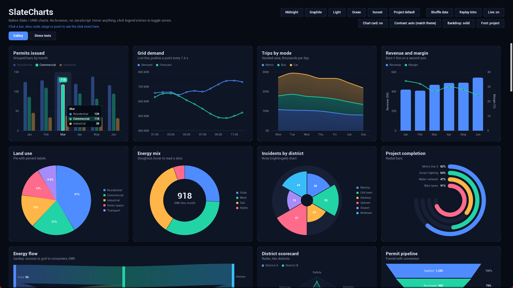

# SlateCharts

Native Slate and UMG charts for Unreal Engine. No web browser, no JavaScript, no CEF.

This repository has:

- **[Documentation](https://ahmad-farrag.github.io/SlateCharts/)** for SlateCharts, the full plugin sold on Fab (about 30 chart widgets, themes, data zoom, drill-down, JSON input, touch, keyboard and gamepad support).
- **[SlateCharts Lite](Lite/SlateChartsLite)**, a free, MIT-licensed plugin with one widget that draws bar, line and pie charts. Use it, learn from it, or try the idea before buying the full version.

## SlateCharts Lite quick start

1. Copy `Lite/SlateChartsLite` into your project's `Plugins/` folder and open the project.
2. In a Widget Blueprint, drag **Slate Lite Chart** from the Palette (category **SlateCharts Lite**).
3. Set **Chart Type**, **Title**, **Categories** and **Series** in the Details panel, or call **Set Data** at runtime.

Details: [SlateCharts Lite docs](https://ahmad-farrag.github.io/SlateCharts/lite).

## Lite or full?

| | Lite (free) | SlateCharts (Fab) |
|---|---|---|
| Chart types | Bar, line, pie | About 30 |
| Themes, fonts, transparent mode | No | Yes |
| Project Settings defaults | No | Yes |
| JSON input | No | Yes |
| Data zoom, drill-down, click-to-pin | No | Yes |
| Touch, keyboard, gamepad | No | Yes |
| Frame caching | No | Yes |
| Showcase level | No | Yes |

## Support

Questions and bug reports: [open an issue](https://github.com/ahmad-farrag/SlateCharts/issues). More on the [support page](https://ahmad-farrag.github.io/SlateCharts/support).

## License

The code in `Lite/` is under the [MIT License](LICENSE). The full SlateCharts plugin is not in this repository; it is sold on Fab under the Fab Standard License.

By Ahmed Farrag · [ahmedfarrag.me](https://ahmedfarrag.me) · [aetherpixels.com](https://aetherpixels.com)
