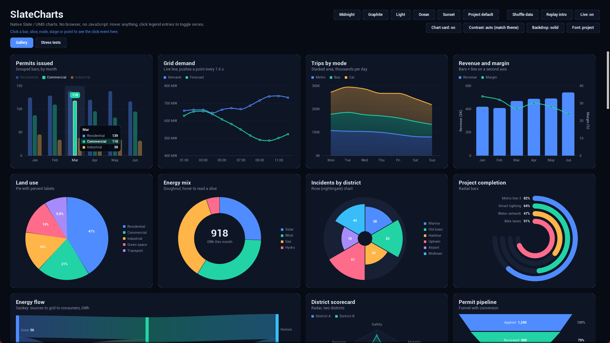
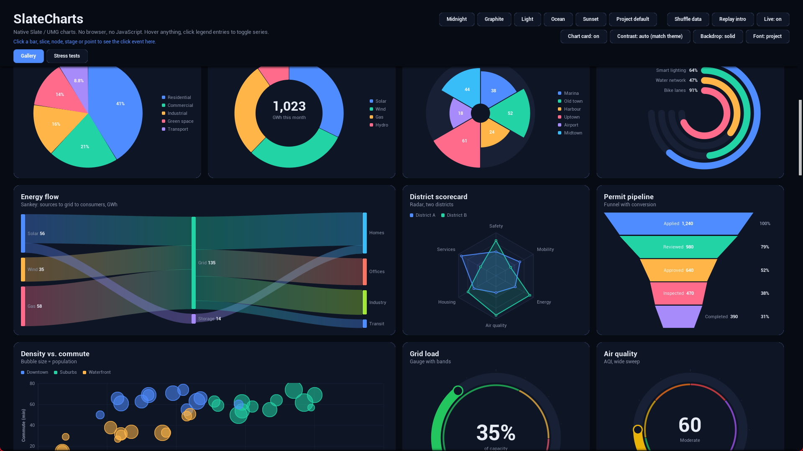
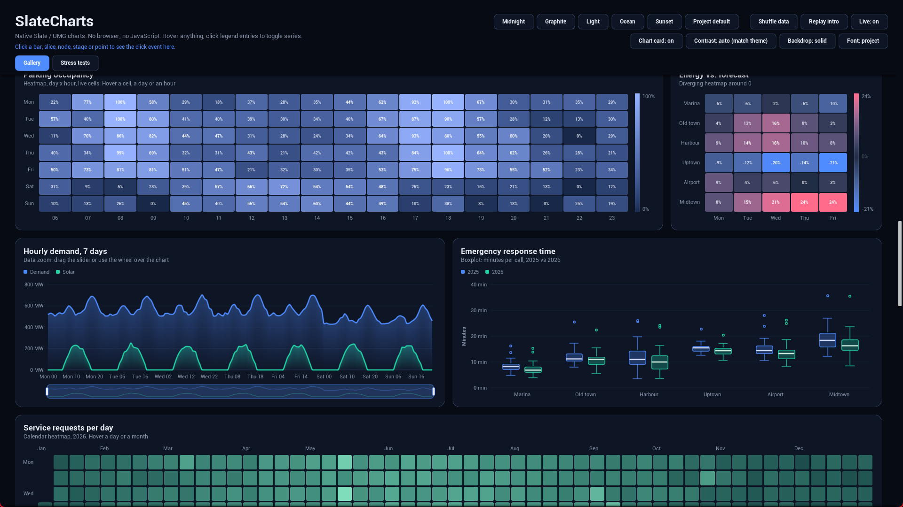
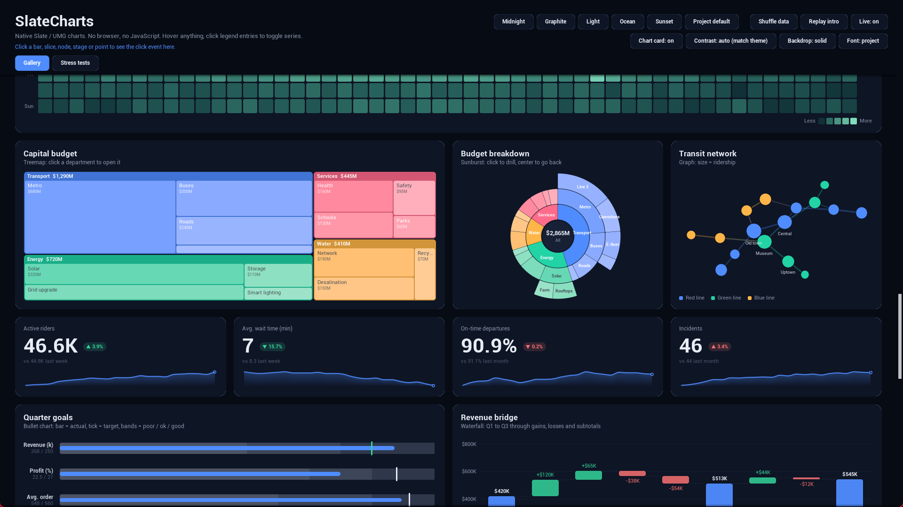
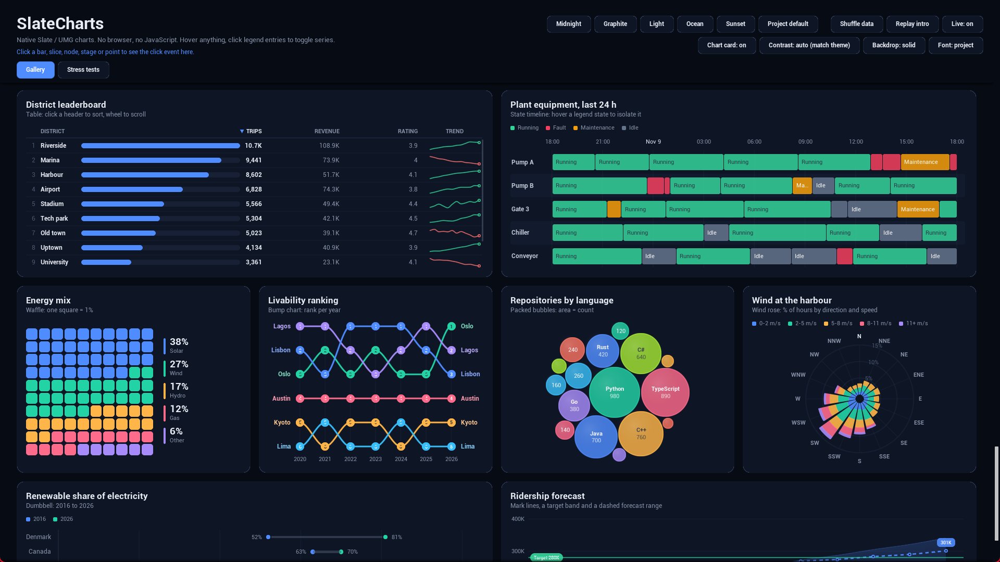
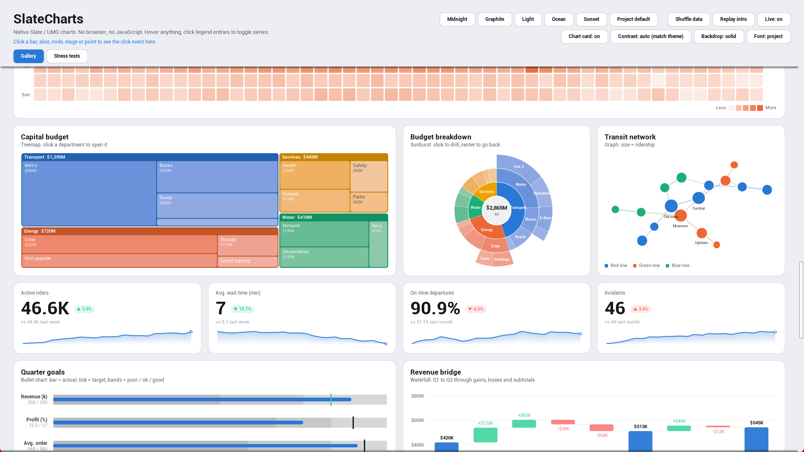
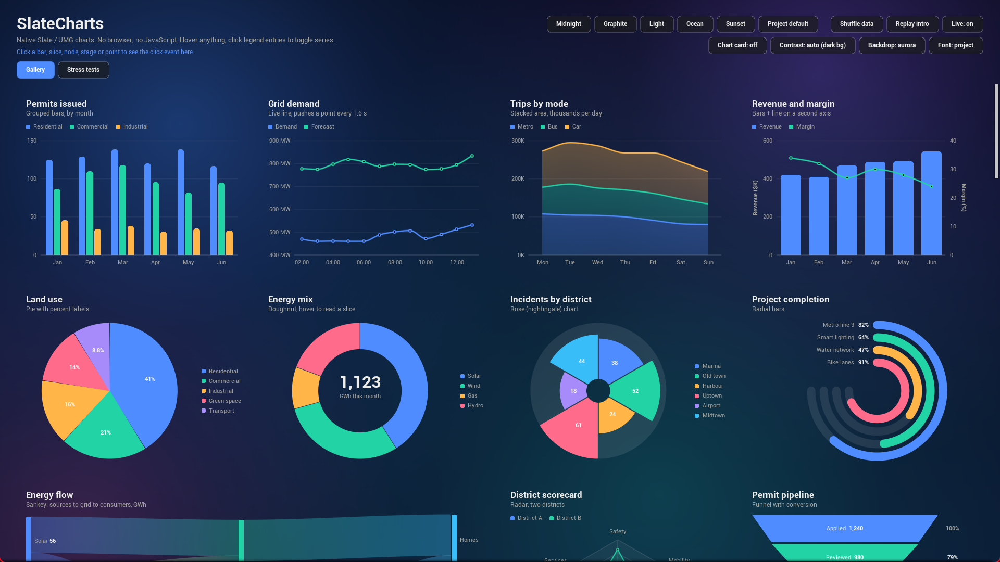

# SlateCharts documentation

SlateCharts is an Unreal Engine plugin with about 30 chart widgets for UMG, drawn natively in Slate. It has no web browser, no JavaScript and no CEF, so the charts work in packaged games and cost little to draw.

## Pages

- [Getting started](getting-started): install, add a chart to a widget, give it data
- [Chart widgets](charts): every chart type and its data struct
- [Feeding data](data): Blueprint structs, JSON, live updates, mark lines
- [Interaction](interaction): hover, legend, pinning, data zoom, drill-down, touch, keyboard and gamepad
- [Look and project settings](settings): themes, fonts, transparent charts, project-wide defaults
- [Layout and edge cases](layout): long labels, odd numbers, bad data, known limits
- [C++ and raw Slate](cpp): using the plots without UMG, writing a new chart type
- [SlateCharts Lite](lite): the free, minimal version in this repository
- [Support](support): questions, bug reports, contact
- [Changelog](changelog)

## Two versions

| | SlateCharts Lite (free) | SlateCharts (Fab) |
|---|---|---|
| Chart types | Bar, line, pie | About 30, listed in [Chart widgets](charts) |
| Hover readout | Yes | Yes, with two-level focus and click-to-pin |
| Legend | Display only | Hover focus, click to hide or show series |
| Themes | One dark style | Midnight, Graphite, Light, Ocean, Sunset, custom |
| Project Settings defaults | No | Yes |
| JSON input | No | Yes |
| Data zoom, drill-down | No | Yes |
| Touch, keyboard, gamepad | No | Yes |
| Transparent mode, custom fonts | No | Yes |
| Frame caching | No | Yes |
| Showcase level | No | Yes |
| License | MIT | Fab Standard License |

The Lite source is in this repository under [`Lite/`](https://github.com/ahmad-farrag/SlateCharts/tree/main/Lite). The full plugin is sold on Fab.

## More screenshots

