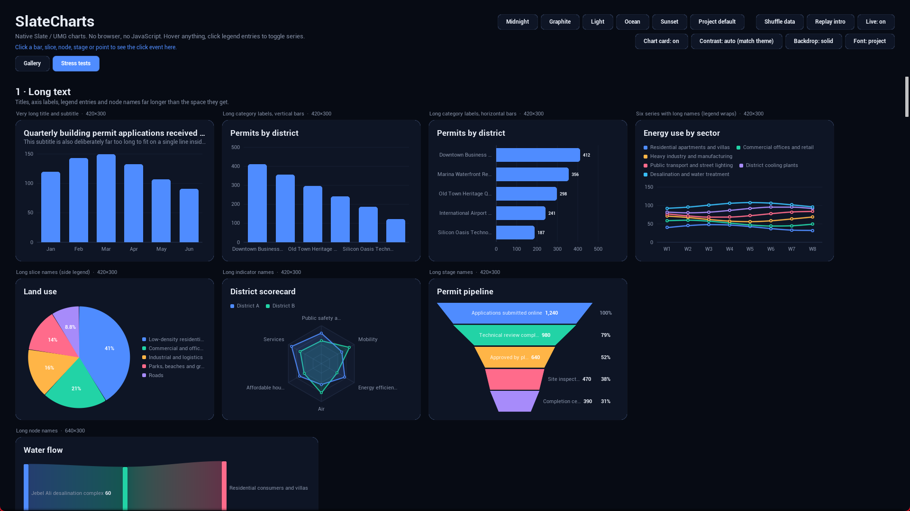

# Layout and edge cases

The showcase's **Stress tests** tab runs about 45 awkward cases: very long titles, labels, legend entries and node names; billions, millionths, negatives, all-equal and all-zero data; empty and single-point data; 30–48 categories and 10 series; and the same charts at thumbnail, wide-strip, narrow-column and large sizes.

## What the charts do

- **Layout follows the widget's shape.** A side legend moves below a narrow chart, a top legend moves beside a wide strip, and when space is short the chart drops, in order, the subtitle, the legend, padding and the title.
- **Text never collides.** Titles, axis labels, legend entries, radar spokes, funnel stages and Sankey nodes are shortened to fit, and the tooltip always has the full name. Axis labels thin out but stay inside the chart.
- **Numbers are never cut off.** Small values keep two significant digits. Gauge and doughnut readouts shrink their font to fit. A gauge value outside its range shows the real number in red while the arc stops at the end.
- **Axes keep their spacing.** Tick count follows the axis length.
- **Bad data degrades gracefully.** Missing values leave gaps, Sankey links that would close a cycle are left out, and a single point sits centred in a scatter.

## Known limits

- Values are 32-bit floats, so differences smaller than about 1 part in 10 million are lost. Near a billion, steps under 64 can't be shown.
- Glyphs the engine fonts lack (such as ☀ ☁ ☂) render as boxes unless you supply a font that has them.
