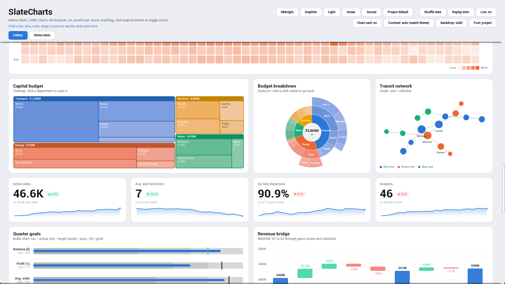
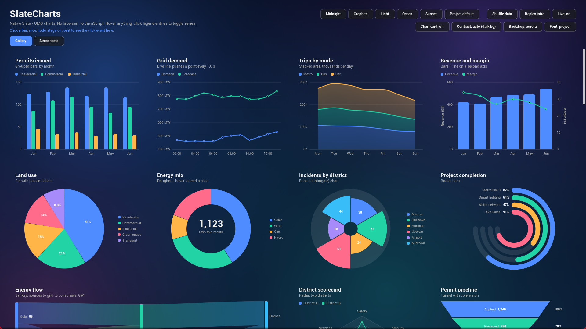

# Look and project settings

## Themes

Each chart has a **Theme**: Project Default (follows Project Settings), Midnight, Graphite, Light, Ocean, Sunset, or Custom. Custom uses your own `FSlateChartStyle`; start from `GetPresetStyle` and change what you need.

## Project-wide defaults

**Project Settings > Plugins > Slate Charts** sets the defaults for every chart in the project. They are saved to `Config/DefaultGame.ini` under `[/Script/SlateCharts.SlateChartsSettings]`.

| Group | Settings | How charts follow it |
|---|---|---|
| Look | Theme (+ Custom Style), Font, Animation Duration, Transparent Background, Background Contrast | Charts whose Theme is Project Default use the project theme. Charts without their own Font use the project font. |
| Numbers | Value Format (style, decimals, prefix, suffix) | Becomes the default of every chart widget |
| Interaction | Show Tooltip, Click To Pin, Legend Hover Focus, Legend Toggles, Focus Fade Time | Becomes the default of every chart widget |

A setting changed on one chart wins for that chart, and **Reset to default** returns it to the project value. Changes show immediately in open widget blueprints and in Play In Editor, without restarting the editor.

## Fonts

**Font** (`FSlateChartFont`) sets the typeface for all of a chart's text, with any theme. Pick a Font asset as `Family`, and name the typefaces for regular and bold text (for example `Light` / `Medium`). Leave `Family` empty to keep the theme's font.

Blueprint: `SetFont(FontAsset, Regular, Bold)`; pass None to go back.

The font asset's cache type must be **Runtime**. For Arabic or CJK data, the font needs those glyphs or a fallback sub-font. Arabic and other right-to-left scripts are shaped correctly in titles, labels, legends and tooltips.

## Transparent charts

`bTransparentBackground` drops the chart card so the chart sits directly on your scene, video or panel. `BackgroundContrast` picks the text, grid and tooltip colors for what is behind it (`MatchTheme`, `DarkBackground`, `LightBackground`) and keeps the theme's series colors.

Blueprint: `SetTransparentBackground`.

